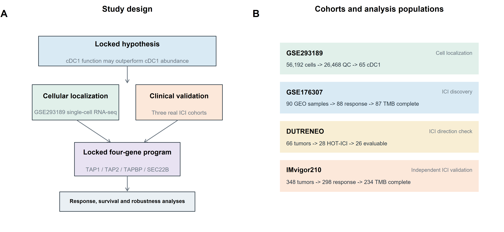
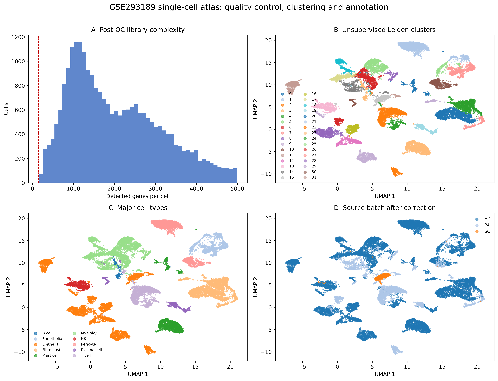
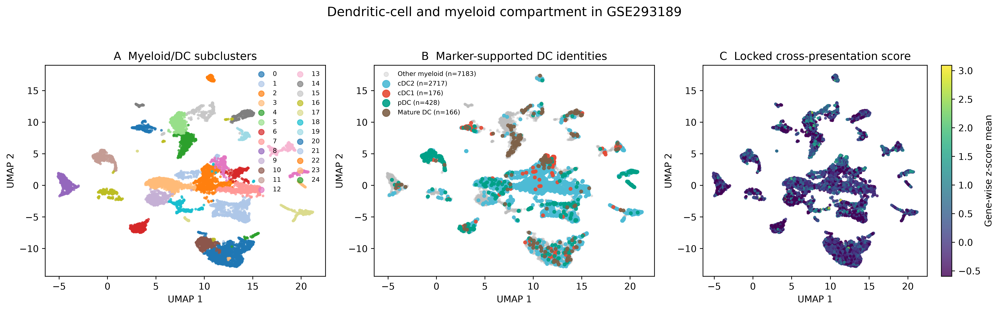
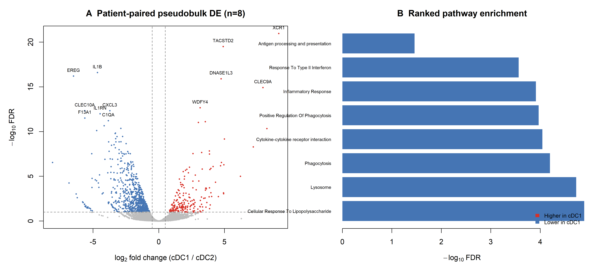
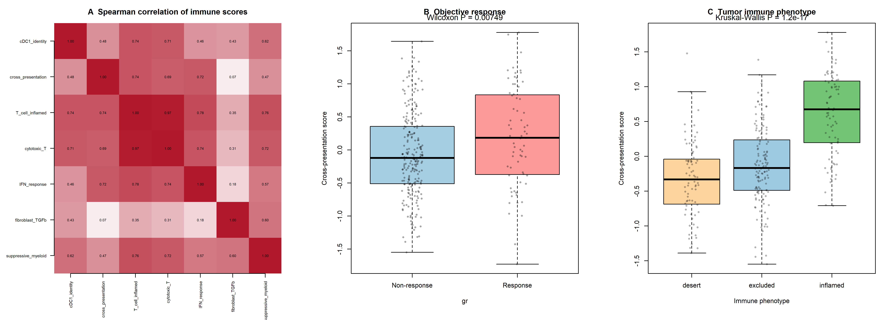
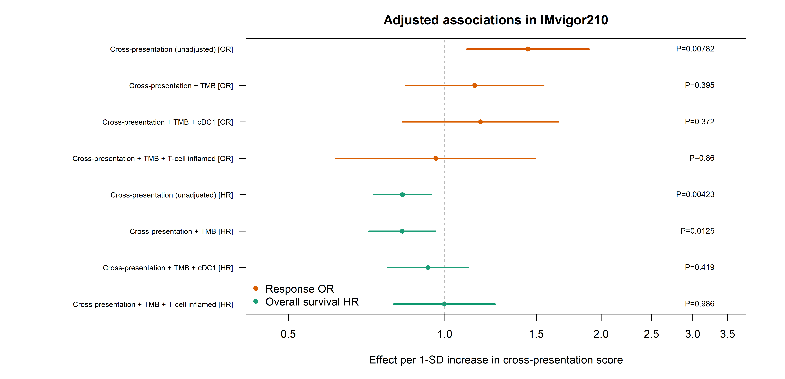

# BLCA-cDC1-XP

**BLCA-cDC1-XP** (Bladder Cancer cDC1 Cross-Presentation) provides reproducible code, compact derived data and manuscript-ready figures for studying conventional type 1 dendritic cells (cDC1), antigen cross-presentation programs and immune-checkpoint treatment outcomes in bladder cancer.

[中文说明](README_zh-CN.md) · [Data guide](docs/DATA.md) · [Reproduction guide](docs/REPRODUCIBILITY.md) · [Results notes](docs/RESULTS_INTERPRETATION.md)

> Status: analysis repository for an in-preparation manuscript. The repository supports computational reproduction; it is not a clinical prediction tool.



## Research question

The project evaluates three linked questions:

1. Can cDC1 and related dendritic-cell states be identified robustly in bladder cancer single-cell data?
2. Which patient-level transcriptional programs distinguish tumor cDC1 from cDC2 and other myeloid states?
3. Is a locked cross-presentation score associated with an inflamed tumor microenvironment, immune-checkpoint response and overall survival?

The locked cross-presentation score uses **TAP1, TAP2, TAPBP and SEC22B**. Identity markers such as **XCR1, CLEC9A and WDFY4** are analyzed separately to reduce circularity.

## Main findings

- Standard processing of GSE293189 retained 24,715 cells from 67 libraries and identified 32 Leiden clusters.
- The myeloid/DC compartment contained 10,670 cells; 82 tumor cDC1 cells were detected across 14 patients.
- Patient-paired pseudobulk analysis used eight patients meeting the primary minimum-cell rule. cDC1 showed higher XCR1, CLEC9A, WDFY4, DNASE1L3 and TAP1 than cDC2.
- Broad antigen processing/presentation pathways were not uniformly cDC1-enriched; MHC-II/lysosomal programs were stronger in cDC2. The evidence therefore supports selected cross-presentation genes, not global activation of every antigen-presentation pathway.
- In IMvigor210, the cross-presentation score was associated with objective response and overall survival in unadjusted models, but the association attenuated after adjustment for TMB, cDC1 identity or a T-cell-inflamed score.

The most defensible interpretation is that the score marks a **cDC1–T-cell-inflammation axis**, not yet an independent clinical predictor.

## Repository structure

```text
.
├── scripts/
│   ├── 01_standard_single_cell_atlas.py
│   ├── 02_refine_dc_annotations.py
│   ├── 03_pseudobulk_de_enrichment.R
│   ├── 04_extract_imvigor210.R
│   ├── 05_imvigor210_locked_scores.R
│   ├── 06_imvigor210_immune_context.R
│   └── 07_generate_manuscript_figures.R
├── data/
│   └── derived/               # compact, non-raw inputs needed downstream
├── results/                   # statistical result tables
├── figures/                   # PNG, PDF and SVG manuscript figures
├── docs/
├── environment.yml
├── CITATION.cff
└── LICENSE
```

## Quick start

```bash
git clone https://github.com/fengzhen01/blca-cdc1-xp.git
cd blca-cdc1-xp
conda env create -f environment.yml
conda activate blca-cdc1-xp
```

Download the raw datasets according to [docs/DATA.md](docs/DATA.md), then place them under `data/raw/` using the documented names.

```bash
python scripts/01_standard_single_cell_atlas.py
python scripts/02_refine_dc_annotations.py
Rscript scripts/03_pseudobulk_de_enrichment.R
Rscript scripts/04_extract_imvigor210.R data/raw/IMvigor210CoreBiologies/cds.RData results/IMvigor210_validation
Rscript scripts/05_imvigor210_locked_scores.R results/IMvigor210_validation/IMvigor210_fixed_data.rds results/IMvigor210_validation
Rscript scripts/06_imvigor210_immune_context.R
Rscript scripts/07_generate_manuscript_figures.R
```

Scripts expect execution from the repository root. Full details, expected outputs and analysis caveats are provided in [docs/REPRODUCIBILITY.md](docs/REPRODUCIBILITY.md).

## Data policy

Raw single-cell matrices, the full H5AD objects, the IMvigor210 source package and third-party article PDFs are deliberately excluded from GitHub. Reasons include repository size, redistribution terms and provenance. Compact patient-level pseudobulk matrices, metadata and statistical result tables are included where appropriate. See [docs/DATA.md](docs/DATA.md).

## Figures

| Analysis | Preview |
|---|---|
| Standard single-cell atlas |  |
| DC/myeloid subclusters |  |
| Pseudobulk DE and enrichment |  |
| Immunotherapy immune context |  |
| Adjusted clinical models |  |

## Citation

The manuscript citation will be added after publication. Until then, cite this software using `CITATION.cff` and cite the original public datasets used in the analysis.

## License and disclaimer

Source code is released under the MIT License. Dataset and publication rights remain with their respective owners. Results are intended for research use only and must not be used for diagnosis, treatment selection or other clinical decisions.
