# Analysis workflow

```mermaid
flowchart LR
    A[GSE293189 raw DGE matrices] --> B[QC and per-library doublet detection]
    B --> C[Feature-union alignment]
    C --> D[Normalization, HVG, PCA and source-batch correction]
    D --> E[Leiden clustering and UMAP]
    E --> F[Major cell annotation]
    F --> G[Myeloid/DC reclustering]
    G --> H[Marker-supported cDC1, cDC2, pDC and mature DC]
    H --> I[Patient-level pseudobulk]
    I --> J[edgeR paired DE]
    J --> K[GO/KEGG ranked enrichment]
    L[IMvigor210] --> M[Locked immune scores]
    M --> N[Response, survival and immune-context models]
    K --> O[Integrated interpretation]
    N --> O
```

The analysis deliberately separates cDC1 identity markers from the locked non-overlapping cross-presentation score. Statistical inference uses patients or bulk samples as biological units rather than treating cells as independent replicates.

